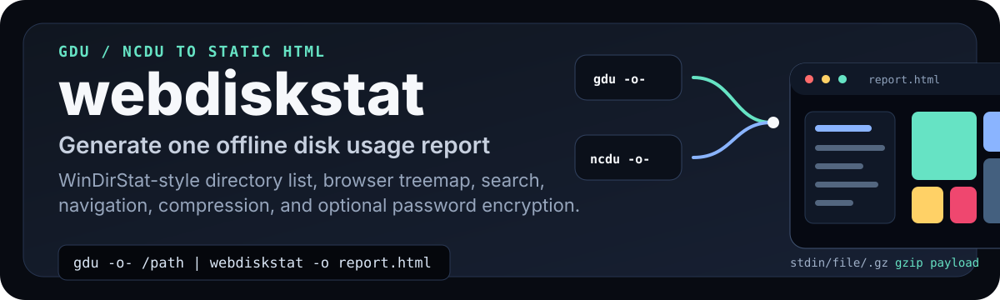
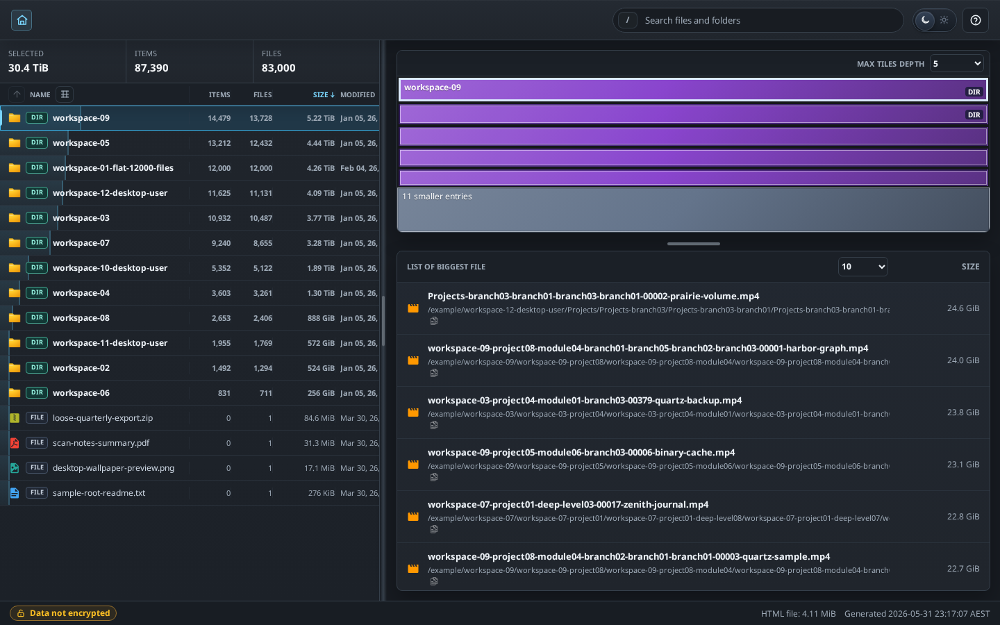

<p align="center">
  
</p>

# webdiskstat

`webdiskstat` converts JSON from [`gdu -o-`](https://github.com/dundee/gdu) or [`ncdu -o-`](https://dev.yorhel.nl/ncdu) into a self-contained disk usage HTML report you can open in a browser. It gives scanner output a WinDirStat-style directory list, browser treemap, search, keyboard navigation, a compressed embedded payload, and optional password encryption without running a web server.

[Try the live example report](https://htmlpreview.github.io/?https://github.com/rwahyudi/webdiskstat/blob/main/example/report.html) before generating your own.

## See It



The included example uses 83,000 generated files across 12 uneven top-level workspaces and 4 loose root files, including one workspace with 12,000 direct files, so it exercises large-directory navigation and search.

## Quick Start

Generate a `gdu` report:

```sh
gdu -o- /path/to/scan | webdiskstat -o diskstats.html
```

Open `diskstats.html` in a browser. The report is a static HTML file with no network dependencies, so it can be viewed offline or shared as a single artifact.

## Download and Install

Download a release package from [GitHub Releases](https://github.com/rwahyudi/webdiskstat/releases/latest).

Linux x86-64:

```sh
curl -L -o webdiskstat-linux-amd64.tar.gz https://github.com/rwahyudi/webdiskstat/releases/latest/download/webdiskstat-linux-amd64.tar.gz
tar -xzf webdiskstat-linux-amd64.tar.gz
install -Dm755 webdiskstat ~/.local/bin/webdiskstat
```

Verify a downloaded release before installing it:

```sh
curl -LO https://github.com/rwahyudi/webdiskstat/releases/latest/download/SHA256SUMS
sha256sum --ignore-missing -c SHA256SUMS
```

Windows x86-64 PowerShell:

```powershell
Invoke-WebRequest -Uri https://github.com/rwahyudi/webdiskstat/releases/latest/download/webdiskstat-windows-amd64.zip -OutFile webdiskstat-windows-amd64.zip
Expand-Archive .\webdiskstat-windows-amd64.zip -DestinationPath .
.\webdiskstat.exe --help
```

## Features

| Area | What it does |
| --- | --- |
| Inputs | Reads `gdu -o-` JSON by default, `ncdu -o-` JSON with `--input-type ncdu`, stdin, saved JSON files, and `.gz` exports. |
| Output | Writes one self-contained HTML disk usage report with embedded scan data, fonts, icons, and favicon. |
| Browser UI | Provides sortable columns, configurable visible columns, nested treemap tiles, breadcrumb navigation, browser back/forward support, bookmarkable URL hashes, and a biggest-files view. |
| Scale | Virtualizes large directory listings, keeps the 50 largest files, and builds a compact global search index only when search is first used. Search is disabled above 5,000,000 files or a 512-million-character index budget to protect browser memory. |
| Security | Can encrypt embedded scan data with `--password` using PBKDF2-SHA256 and ChaCha20-Poly1305. Encrypted reports prompt for the password in the browser. |
| Offline use | Generated reports work as static files after generation without Go, `gdu`, `ncdu`, or a web server. |

## More Examples

Generate an `ncdu` web report:

```sh
ncdu -o- /path/to/scan | webdiskstat --input-type ncdu -o diskstats.html
```

Generate a disk usage HTML report from a saved scanner export:

```sh
gdu -o report.json /path/to/scan
./webdiskstat report.json -o diskstats.html
```

Read a compressed scanner export:

```sh
./webdiskstat report.json.gz -o diskstats.html
```

## Compare GDU Snapshots

Use `--diff` with a baseline first and a later snapshot second:

```sh
gdu -o before.json /path/to/data
# Capture the same scan root again after changes.
gdu -o after.json /path/to/data
webdiskstat --diff before.json after.json -o changes.html
```

Comparison accepts GDU JSON exports and `.gz` exports only. Both scan roots must match; different roots cause an error rather than an implicit relative-path comparison. NCDU remains supported for single-input reports, not comparisons. At most one comparison input can be `-` for stdin.

The offline comparison report includes before/after totals, net and percentage changes, separate storage increases and decreases, largest changes, and a searchable, sortable changes-only directory browser with status filters and CSV export. Ancestor directories remain navigable even when their net change is zero. Optional `--password` encryption protects the embedded comparison data just as it does single-input reports.

Add `--complete` (or `-c`) to include unchanged branches as well:

```sh
webdiskstat --diff --complete before.json after.json -o complete-changes.html
```

The report identifies its mode as **Changes only** (the default) or **Complete**. Complete mode retains all paths from either snapshot for browsing; change totals, rankings, and CSV export still include only actual changes. Including unchanged branches can substantially increase report size and browser memory use. `--complete` requires `--diff`.

Comparison reports use the normal report's compact styling and dark/light theme switcher. Theme preferences are remembered when browser storage is available.

The comparison file browser uses the normal report's selection and directory-navigation controls, keyboard shortcuts, sortable/resizable optional columns, path copying, bookmarkable navigation, and virtualized scrolling. Size and file-count shortcuts sort by **After size** and **After file count**; comparison-specific columns remain independently sortable.

The summary and largest-changes sections each span the report width. Largest changes displays 10 entries per category by default, selectable up to 100. Its rankings use one dedicated embedded dataset, independent of file-browser search, filters, sorting, and pagination. Both datasets remain inside the self-contained report and are encrypted together when `--password` is used.

This compares recorded usage and metadata, not file contents. Renames appear as a removal and an addition; unchanged file size and metadata do not prove identical contents. For meaningful results, capture both snapshots with consistent scanner settings and coverage.

Comparison uses compact in-memory snapshot records and numeric references rather than retaining two generic JSON trees plus a separate complete diff tree. Its binary payload is compressed incrementally and the HTML is streamed to a staged output file. This is not a disk-backed comparison database: memory still grows with the number of entries and the lengths of their paths. Complete mode retains every path from either snapshot without changing change counts, rankings, or CSV semantics.

Each input is limited to 512 MiB on disk and 1 GiB after decompression; the two snapshots together are limited to 5,000,000 nodes (files and directories). Native GDU export arrays are parsed incrementally, with additional limits on JSON tokens, nesting, metadata, and retained path bytes. Other supported JSON shapes use a compatibility path limited to 16 MiB after decompression and bounded normalized path expansion. Temporary compressed data uses `TMPDIR`; staged file output is created beside the destination and replaces it only after generation succeeds. New comparison reports are private (`0600`); replacing an existing regular report preserves its permissions. It is not intended for 100-million-file scans.

Encrypted comparisons preserve the existing authenticated-encryption format and accept up to 64 MiB of compressed comparison data. Above that limit, generation fails explicitly rather than silently removing encryption or paths. Large complete reports can still use substantial memory when opened in a browser; terminal-generator memory and browser memory are separate concerns.

New comparisons use the `gds-diff-binary-v2` payload: shared strings, compact numeric records, and sparse before-value overlays. Unchanged entries inherit their before-values from the current snapshot rather than storing those values twice. Removed paths remain in the merged directory tree. Before-values are also retained when a count changes without a status change, so all comparison columns remain accurate. The browser decodes this binary data directly; the verbose whole-report JSON representation is no longer generated. Older JSON-format comparison reports remain supported by the legacy incremental decoder. The loaded directory tree still occupies browser memory. If a loading attempt fails after its embedded payload has been released, Retry reloads the report to start cleanly.

The validation dataset contains 1,860,935 and 1,871,861 input entries, with a union of 1,874,376 paths including 1,857,761 unchanged paths. Complete-mode checks verify that exact path union as well as summaries, change counts, browser navigation, and CSV behavior. One collection at the comparison-to-rendering handoff releases completed snapshot/index work; no `GOMEMLIMIT` or `GOGC` override is required. Performance measurements are dataset/environment-specific, not a universal memory guarantee.

On this dataset, complete binary generation took 26.2 seconds with approximately 1.85 GiB peak RSS under a hard 2 GiB/no-swap limit. The expanded payload is 39.08 MiB and the HTML is 15.15 MiB, compared with 646.95 MiB and 35.45 MiB for the previous JSON diff. Headless Chromium opened the regenerated binary diff offline in 6.5 seconds versus 79 seconds for JSON; the normal 1,871,861-entry report opened in 3.5 seconds on the same machine. The full browser/path/CSV validation used a 3 GiB/no-swap cap, with a 1.9 GiB process-group peak. Sparse overlays covered 16,615 entries; unchanged paths were not omitted.

## Options

```text
usage: webdiskstat [--input-type gdu|ncdu] [-o OUTPUT] [--password PASSWORD] [input]
       webdiskstat --diff [--complete|-c] [-o OUTPUT] [--password PASSWORD] baseline current
```

- `input`: scanner JSON file, `.gz` file, or `-` for stdin. Defaults to stdin.
- `--input-type`: input JSON format, either `gdu` or `ncdu`. Defaults to `gdu`.
- `--diff`: compare exactly two GDU exports, baseline first and current second. Without this flag, only one input is accepted.
- `-c, --complete`: include unchanged branches in a comparison report. Requires `--diff`; omitted by default.
- `-o, --output`: output HTML path, or `-` for stdout. Defaults to `webdiskstat.html`. Parent directories are created automatically; an existing output file is replaced.
- `--password PASSWORD`: encrypt the embedded scan data. Defaults to unencrypted.
- `-v, --version`: print the version and the build date in local time.

Running the command without piped input or an input file prints the usage instructions. Argument errors use exit status 2; input, conversion, and output errors use exit status 1.

### Terminal feedback

When stderr is an interactive terminal, report generation shows an animated PTerm spinner with the current stage and elapsed time. Successful generation prints the output location, HTML file size, duration, and file/folder counts. Comparisons also show change counts and the report mode. This display does not change the comparison algorithm or report contents.

Progress and statistics go to stderr, so `-o -` still produces only HTML on stdout and piped scanner input remains supported. Redirected stderr keeps the existing plain output without animation. `NO_COLOR` disables color; `TERM=dumb` and CI environments disable animation.

The Go 1.25-compatible PTerm dependency is vendored with a local spinner synchronization fix so updates and shutdown do not race. Preserve that fix in `vendor/github.com/pterm/pterm/spinner_printer.go` when refreshing vendored dependencies, until an upstream version provides equivalent synchronization. The existing `vendor/material-file-icons` assets must also be preserved.

## Encryption

Encrypt the embedded report data with `--password`:

```sh
./webdiskstat report.json -o diskstats.html --password 'choose-a-strong-password'
```

Encrypted reports use Web Crypto when available and include a JavaScript fallback for `file://` and other non-HTTPS schemes. Unencrypted reports disclose the scan metadata embedded in the HTML, and encrypted reports still depend on password strength.

## Interface

- The left panel lists the current directory entries, including modified time when the scan data provides it.
- Columns are sortable by name, item count, file count, size, and modified date.
- Optional columns can be shown or hidden from the column settings button next to the Name header.
- The toolbar search finds files and directories across the whole report and jumps to the selected result. Its compact node-reference index is built only when search is first used and is disabled above 5,000,000 files or a 512-million-character index budget.
- The treemap shows the current directory, including nested subdirectories and files inside larger directory tiles when space allows.
- The home view shows a smaller treemap and a framed biggest-files list.
- Details show size, percentage, type, extension, item count, file count, and modified time when the scan data provides it.
- The Help button in the toolbar, or the `?` shortcut, explains mouse actions, keyboard shortcuts, and navigation.

## Navigation

- Breadcrumbs, the parent button, and browser back/forward move between directories.
- Use the search box, `/`, or `Ctrl+F` to find files and directories across the report.
- Double-click a directory row or treemap tile to enter it. Keyboard users can focus rows or tiles and press `Enter` or `Space`.
- Double-click a file or largest-files row to jump to the directory containing that file.
- The URL hash changes as you navigate, so directory views are bookmarkable.
- `Arrow Up` / `Arrow Down`: move selection in the directory list.
- `Page Up` / `Page Down`: move selection by one visible page.
- `Home` / `End`: jump to the first or last item.
- `Enter` / `Arrow Right`: enter the selected directory.
- `Backspace` / `Arrow Left`: go up one directory.
- `n` / `s` / `C` / `M` or `m`: sort by name, size, file count, or modified time. Repeating the same shortcut toggles ascending or descending order.
- `?`: open the Help dialog.

## Compression and Security

The generated report embeds scan data as a compact string-table payload that is gzip-compressed before being stored in the HTML.

- Viewing generated reports requires a current maintained Chrome, Edge, Firefox, or Safari release with the standard `DecompressionStream` API. Reports are supported when opened directly with `file://`.
- Encrypted reports show an encrypted data indicator in the footer and prompt for the password before loading scan data.
- Encryption uses PBKDF2-SHA256 key derivation and ChaCha20-Poly1305 payload encryption.
- Reports use the browser Web Crypto API when available and include a slower JavaScript fallback for `file://` and other non-HTTPS schemes.
- Unencrypted reports disclose the scan metadata embedded in the HTML.
- Command-line passwords may be visible in shell history or process lists.
- Input is limited to 512 MiB on disk, 1 GiB after decompression, and 5,000,000 normalized nodes. These limits prevent a malformed or compressed export from exhausting memory.

## Build From Source

### Requirements

- Go 1.25 or newer

```sh
git clone https://github.com/rwahyudi/webdiskstat.git
cd webdiskstat
go build -o webdiskstat .
install -Dm755 webdiskstat ~/.local/bin/webdiskstat
```

Set release metadata at build time with linker flags. `-v` prints this value and date; builds without it use the executable's local modification time.

```sh
go build -ldflags "-X main.version=v1.2.3 -X 'main.buildDate=$(date '+%Y-%m-%d %H:%M:%S %Z')'" -o webdiskstat .
```

`gdu` or `ncdu` is required only when creating a new scanner export. It is not required to convert an existing JSON export.
